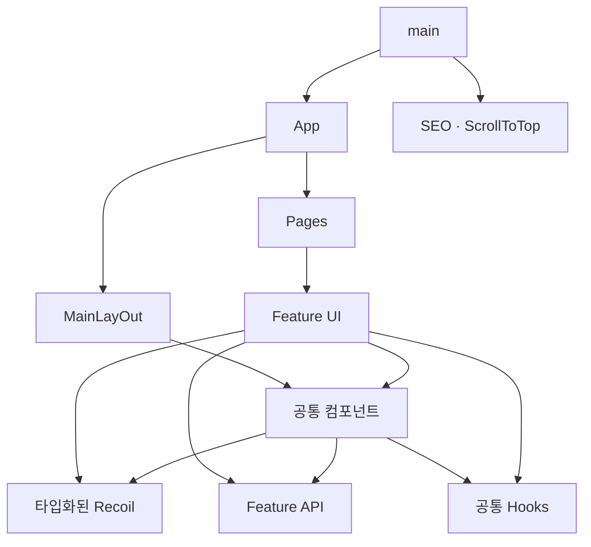

# 4단계 JavaScript → TypeScript 전환 계획

**남은 대상은 135개입니다.** 확인하신 범위에 따라 Feature·Pages뿐 아니라 shared 보조 모듈, widgets, app 엔트리까지 포함합니다. **32개 하위 작업으로 나누고, 작업당 1~8개 파일만 전환합니다.**

소스 수정·파일명 변경·테스트 코드 추가는 하지 않았습니다. 현재 작업 트리는 깨끗합니다.

**1. 남아 있는 JS/JSX 파일 수**

| 구분 | 파일 수 |
|—|—:|
| `.js` | 19 |
| `.jsx` | 116 |
| **합계** | **135** |

이미 전환된 TS/TSX와 `.d.ts`, 에셋, `src` 외부 설정·서버 파일은 제외했습니다.

남은 Feature custom Hook 모듈은 **0개**입니다. 현재 Feature 로직은 컴포넌트 내부의 React/Recoil Hook과 이미 전환한 공통 Hook을 사용합니다. 이번 단계에서 새로운 Hook으로 추출하지 않습니다.

**2. 영역별 파일 분포**

| 영역 | JS | JSX | 합계 | 주요 역할 |
|—|—:|—:|—:|—|
| features | 8 | 91 | **99** | 기능 UI, 옵션·표시 데이터, 기존 Yup 스키마 |
| pages | 0 | 20 | **20** | 라우트 화면, 데이터 조회·모달 조합 |
| widgets | 0 | 1 | **1** | Header·Footer·Outlet 레이아웃 |
| shared | 11 | 2 | **13** | 포맷터, 옵션, 스타일, SEO, 스크롤 처리 |
| app | 0 | 2 | **2** | 라우터, Provider, 지도 로딩, React 엔트리 |
| 기타 | 0 | 0 | **0** | 해당 없음 |

JSX가 없는 `AuthCallback.jsx`, `AuthError.jsx`, `SeoHead.jsx`, `DatePickerGlobalStyle.jsx`는 `.ts`로 전환합니다. 나머지도 실제 JSX 유무로 `.ts`/`.tsx`를 결정합니다.

**3. Feature별 분류·파일 목록**

아래 컴포넌트 수는 **UI 파일 단위**이며, styled-components 선언 수는 포함하지 않습니다. Page 수는 기능별 소속으로 배정했고, 여러 Feature를 조합하는 페이지를 중복 계산하지 않았습니다.

**정확한 전체 파일 목록은 6번 작업표에 통합했습니다.** 각 행의 파일을 합치면 중복·누락 없이 135개입니다.

| Feature      | UI / Hook / 데이터·스키마 | 관련 Page 수 | 주요 API DTO                                                                             | 사용 상태·공통 UI·다른 Feature 의존성                                                                                             |
| ------------ | ------------------------- | -----------: | ---------------------------------------------------------------------------------------- | --------------------------------------------------------------------------------------------------------------------------------- |
| landing      | 5 / 0 / 0                 |            1 | 없음                                                                                     | SearchInput, Swiper·애니메이션. 다른 Feature 의존 없음                                                                            |
| main         | 6 / 0 / 0                 |            1 | `PageResponse<ThemeResponse>`, `ThemeGenre`, `ThemeProficiency`                          | ContentCard·Loading·SearchInput. genre·level API 사용                                                                             |
| search       | 1 / 0 / 0                 |            1 | `GetThemesQuery`, `PageResponse<ThemeResponse>`                                          | SearchInput·ContentCard·CustomPagination. 직접 Recoil 사용 없음                                                                   |
| genre        | 2 / 0 / 1                 |            1 | 테마 목록 DTO, `RegionResponse`, `ZoneResponse`, `ThemeSortOption`                       | `activeGenreState`, 공통 필터·카드·페이지네이션·BottomSheet. location API 사용                                                    |
| level        | 2 / 0 / 1                 |            1 | 테마 목록 DTO, 지역·구역 DTO, `ThemeProficiency`                                         | `activeLevelState`, genre와 같은 공통 UI 및 InfoBox. location API 사용                                                            |
| location     | 6 / 0 / 0                 |            1 | 지역·구역·역·매장 DTO, `LocationStoreInfoResponse`, 테마 목록 DTO                        | location atom의 ID·카드 표시·목록·좌표·줌·페이지 상태. PopUpModal·BottomSheet, like API                                           |
| survey       | 9 / 0 / 2                 |            1 | `PatchMemberPreferenceRequest`                                                           | 가입 설문 `surveyState`, `surveySectionState`, `modalState`, `PreferenceDraft`                                                    |
| auth         | 14 / 0 / 1                |            2 | 가입·닉네임 DTO, `MemberInfoResponse`, `MemberPreferenceResponse`                        | 가입 단계·닉네임 백업·회원정보 모달 atom, Loading, 공유 인증 조정 함수. survey 옵션 데이터 사용                                   |
| mypage       | 17 / 0 / 2                |            5 | 회원정보·성향·찜 목록·예약·내 후기·후기 상세 DTO                                         | favorite·survey·reservation·reviewSort 상태와 후기·일정 atom. ContentCard·PopUpModal, schedule·review UI 사용                     |
| review       | 16 / 0 / 1                |            1 | `ThemeReviewMutationInput`, `PostReviewResult`, 성향 응답 DTO                            | `reviewStateFamily`, `reviewSectionState`, `reviewModalState`, InfoBox·PopUpModal. themeDetail 상태와 mypage API 사용             |
| reviewDetail | 4 / 0 / 0                 |            1 | `ThemeReviewDetailResponse`                                                              | InfoBox, review의 RangeItem. UI 내부 직접 Recoil 사용 없음                                                                        |
| schedule     | 3 / 0 / 0                 |            0 | 테마 검색·상세·예약 DTO                                                                  | `scheduleModalState`, `calendarMonthState`, `reservationListState`, PopUpModal. mypage ReservedCard와 review VisitDatePicker 사용 |
| themeDetail  | 6 / 0 / 0                 |            1 | `ThemeDetailResponse`, `ThemePriceResponse`, `ThemeReviewListResponse`, `ThemeReviewDto` | 후기·회원정보·일정 모달 atom, PopUpModal. schedule UI와 like API 사용                                                             |

추가로 정적 안내 Page 3개가 있습니다. `like` Feature는 API가 이미 TS이며 남은 JS/JSX 대상은 없습니다.

**4. 주요 의존성 구조**

다음은 **import 방향**입니다.



- shared 공통 컴포넌트에서 **Feature UI를 import하는 관계는 없습니다.** 다만 ContentCard·Header 등은 Feature API나 Recoil 상태를 사용합니다.
- Feature에서 Pages를 역으로 import하는 관계도 없습니다. Pages가 여러 Feature를 조합합니다.
- 공통 `useDevice`, `useDropDown`은 UI·DOM 처리를 담당합니다. `useAuthSession`은 공유 상태를 구독하고, 인증 조회 조정은 `authSession.ts`가 담당합니다.
- `App`은 경로·인증 보호 분기·지도 로딩을, `MainLayOut`은 Header·Footer 표시를 담당합니다. 따라서 마지막에 전환합니다.

중요한 Feature 간 연결은 다음과 같습니다.

| 연결 | 전환상 의미 |
|—|—|
| auth·mypage → survey 옵션 데이터 | 공통으로 사용하는 설문 옵션부터 전환 |
| reviewDetail → review/RangeItem | 후기 입력 전체보다 RangeItem을 먼저 전환 |
| schedule → review/VisitDatePicker | 날짜 입력을 일정 UI보다 먼저 전환 |
| schedule → mypage/ReservedCard | 예약 카드의 목록용·모달용 계약을 먼저 분리 |
| mypage/ScheduleSection → schedule/ScheduleModal | 일정 모달 전환 후 예약 화면 통합 |
| themeDetail → schedule/ScheduleModal | 테마 상세 통합은 일정 모달 이후 |
| mypage/ReviewCardSection → review/ReviewWriteModal | 후기 모달 전환 후 내 후기 화면 통합 |

Feature 단위로는 `mypage ↔ schedule`, `mypage ↔ review`, `themeDetail ↔ schedule` 연결이 있습니다. **현재 정적 분석에서 확인한 실제 파일 단위 런타임 순환은 `API.ts ↔ authAPI.ts`입니다.** 이는 기존 구조로 별도 관리합니다.

새 타입은 UI 컴포넌트에서 역으로 가져오지 않습니다. 기존 DTO·모델 타입을 `import type`으로 사용하고, 여러 Feature가 공유하는 UI 계약은 UI import가 없는 타입 모듈에 둡니다. 기존 Feature 간 연결을 확대하거나 구조를 재편하지 않습니다.

**5. 추천 전환 순서와 이유**

1. **공통 보조 모듈·옵션·스타일**: 남은 UI의 타입 추론 기반을 먼저 확보합니다.
2. **랜딩·안내·메인·검색**: 인증 전환이나 변경 API 의존성이 낮습니다.
3. **장르·숙련도·찜 목록·지역**: 이미 정한 DTO·필터 Props·Recoil 타입을 재사용합니다.
4. **회원 성향 표시·설문·성향 편집**: 읽기 UI부터 전환하고 변경 요청은 mock으로 검증합니다.
5. **후기 입력 하위 UI → 예약 카드 → 일정 모달**: 서로 재사용하는 컴포넌트를 먼저 전환합니다.
6. **테마 상세·후기 상세·내 후기·공유**: 복합 모달과 draft 복원·공유 계약을 통합합니다.
7. **가입·로그인 연결 → 레이아웃·라우터·엔트리**: 인증과 앱 전체에 영향을 주는 작업을 마지막에 배치합니다.

각 작업 내부에서도 옵션·하위 컴포넌트 → 조합 컴포넌트 → Page 순서로 진행합니다.

**6. 4단계 하위 작업 계획**

경로는 모두 `src/` 기준입니다. `{A,B}.jsx`는 각 파일을 뜻합니다. 각 단계에 명시한 파일 외에는 **깨지는 명시적 확장자 import와 필요한 타입 지원만 최소 수정**합니다.

| 단계 | 전환 대상 파일 | 수 | 주요 타입·주의 사항 | 최소 런타임 확인 |
|—|—|—:|—|—|
| **4-1** | `shared/utils/{analytics,dataUtils,formatUtils,scrollToTopFunc,stationLineUtils}.js`, `shared/components/filter/OptionList.js` | 6 | 포맷터의 null·undefined·빈 값, SVG 컴포넌트, 정렬 union, analytics ID. 기존 변환 결과 유지 | 포맷터 경계값, 로그인 이벤트 중복 방지, 경로 이동 스크롤 |
| **4-2** | `shared/styles/{DatePickerGlobalStyle.jsx,FilterStyles.js,LocationFilterStyles.js,ReviewStyles.js,googleMapStyles.js}` | 5 | styled Props, 지도 스타일 타입. CSS 문자열 유지 | 필터·달력·지도 스타일 비교 |
| **4-3** | `features/genre/model/genreData.js`, `features/level/model/levelData.js`, `features/survey/model/{surveyGenreList,surveyPreferenceList}.js`, `features/review/modal/reviewDataList.js`, `features/mypage/model/{reservationDataList,reviewDataList}.js` | 7 | literal union, 옵션·SVG·표시 항목. 미참조 파일도 삭제하지 않음 | 옵션 값·순서·라벨 동일성 |
| **4-4** | `features/landing/{CarouselItem,InfoListItem,LandingSection1,LandingSection2,LandingSection3}.jsx`, `pages/LandingPage.jsx` | 6 | 이미지·텍스트 Props, Swiper, 스크롤·애니메이션 상태 | 슬라이드, 스크롤 효과, 홈 이동 |
| **4-5** | `pages/{NotFoundPage,TermsPage,PrivacyPage}.jsx`, `shared/seo/{SeoHead.jsx,seoConfig.js}` | 5 | SEO 설정·반환값, DOM meta/link, 안내 화면 | URL별 제목·canonical·robots, 안내 페이지 이동 |
| **4-6** | `features/main/ui/{AwardsSection,GenreCard,GenreSection,HeroSection,LevelSection,LocationSection}.jsx`, `pages/MainPage.jsx` | 7 | 테마 배열, 장르·숙련도 union, Swiper, navigation state | 추천 탭, 카드·검색 이동, 지역 진입값 |
| **4-7** | `features/search/ui/SearchSection.jsx`, `pages/SerachPage.jsx` | 2 | 검색어·결과·페이지 상태. 기존 파일명 오탈자 유지 | 검색 진입, 빈 결과, 페이지 변경 |
| **4-8** | `features/genre/ui/{GenreTabSection,GenreContentSection}.jsx`, `pages/GenrePage.jsx` | 3 | 장르·정렬·지역 필터, callback·ref, 목록 DTO | 데스크톱·모바일 필터, 초기화·적용·페이지 이동 |
| **4-9** | `features/level/ui/{LevelTabSection,LevelContentSection}.jsx`, `pages/LevelPage.jsx` | 3 | 숙련도 union, 4-8과 같은 필터 계약 | 숙련도 진입값·탭·필터·페이지 이동 |
| **4-10** | `features/mypage/ui/favorites/{FavoriteDropDown,ContentCardSection}.jsx`, `pages/myPage/FavoritesPage.jsx` | 3 | 인원 상태, 찜 목록 DTO, 삭제 후 목록 callback | 인원 변경, 빈 목록, mock 찜 해제 반영 |
| **4-11** | `features/location/ui/filter/{LocationPeopleFilter,LocationSortFilter}.jsx`, `features/location/ui/LocationContentCard.jsx` | 3 | 필터 ref·옵션, 테마 DTO, nullable 가격, 공유 인증 구독 | 필터 reset, 카드 이동·이미지·mock 찜 |
| **4-12** | `features/location/ui/{GoogleMapComponent,StationCard}.jsx` | 2 | 지도·마커 타입, 서울/수도권 매장 표시 모델, 좌표·ID | 마커·역 선택, 중심 좌표·줌, 매장 페이지 |
| **4-13** | `features/location/ui/StoreCard.jsx`, `pages/LocationPage.jsx` | 2 | 매장 상세·테마 목록, 지역 진입 state, Sheet ref | 메인→지역 진입, 역→매장, 뒤로가기·모바일 시트 |
| **4-14** | `features/auth/ui/UserInfoModal.jsx`, `features/auth/ui/preferences/{GenreSection,HeadcountSection,InfoSection,PositionSection,PreferenceSection,ProficiencySection,SurveyTag}.jsx` | 8 | 읽기 전용 회원 성향 UI, nullable 필드·회원 ID. 계약 확인 선행 | 성향 있음·없음·로딩·실패, 모달 닫기 |
| **4-15** | `features/survey/ui/{SurveyTag,SurveyProficiencySection,SurveyGenreSection,SurveyHeadcountSection}.jsx` | 4 | 가입 설문 draft·선택 callback·인원 입력 | 선택·해제, 장르 제한, 이전·다음 단계 |
| **4-16** | `features/survey/ui/{SurveyPreferenceSection,SurveyPositionSection,SurveyInfoSection,SurveyCompleteSection,QuitModal}.jsx`, `pages/SurveyPage.jsx` | 6 | 나머지 성향 필드, 단계 union, 저장·취소·reset | 전체 단계 이동, mock 저장, 취소·완료 초기화 |
| **4-17** | `features/mypage/ui/preferences/{GenreSection,HeadcountSection,InfoSection,PositionSection,PreferenceSection,ProficiencySection,SurveyTag}.jsx`, `pages/myPage/PreferencesPage.jsx` | 8 | 응답→UI 상태→요청 경계. optional/null 계약 확인 선행 | 기존 성향 복원, 편집, mock 저장·실패 |
| **4-18** | `features/review/ui/{ReviewDropdown,StarRating,RangeItem,ToggleCheckBox,EscapeTimePicker,HintCounter,FlexibleRangeSelector,VisitDatePicker}.jsx` | 8 | 제네릭 옵션·값·callback, button ref, 날짜·입력 이벤트 | 선택·해제·범위, 달력, 250ms 중복 토글 방지 |
| **4-19** | `features/review/ui/{EscapeResultDetails,InputBox,PlayerBoxSection,ReviewFirst,ReviewThird,ReviewLast}.jsx` | 6 | draft 필드·참여자, UI 테마 Props, nullable 점수·문자열 | 참여자 입력, 점수·의견, 탈출 결과·단계 표시 |
| **4-20** | `features/review/ui/ReviewSecond.jsx` | 1 | `ReviewDraftState`, `uiState`, 참여자 updater, 성향 자동 입력 | 인원 추가·삭제, null 토글, 날짜·힌트·추천 인원 |
| **4-21** | `features/review/ui/ReviewWriteModal.jsx` | 1 | draft→요청, 생성·수정 응답, 완료·공유 데이터. 계약 확인 선행 | mock 작성·수정·실패, 검증 순서, reset·공유 이동 |
| **4-22** | `features/mypage/ui/reservations/{ReservationDropDown,ReservedCard,CalendarSection}.jsx` | 3 | 목록용 예약 DTO와 모달용 preview 분리, Date·월별 Record | 월 이동·예약 건수, 빈 preview, 후기 진입, mock 삭제 |
| **4-23** | `features/schedule/ui/{ScheduleTimePicker,ScheduleItemSection}.jsx` | 2 | 선택 테마 UI 모델, 날짜 union, `reservedAt: string \| null`, 상태 callback | 검색→선택, 날짜·시간 순서, edit 복원·선택 해제 |
| **4-24** | `features/schedule/ui/ScheduleModal.jsx`, `features/mypage/ui/reservations/ScheduleSection.jsx`, `pages/myPage/ReservationsPage.jsx` | 3 | add/edit, submit 상태, 예약 갱신·월별 캐시 | mock 생성·수정·삭제, 월 유지, 모달 닫기·후기 진입 |
| **4-25** | `features/themeDetail/ui/{PriceTable,SummaryInfoCard,ThemeReview,ThemeReviewSection}.jsx` | 4 | 가격·후기 DTO, optional 회원 정보, 페이지·callback | 가격 표, 후기 없음·추가 조회, 회원 모달 진입 |
| **4-26** | `features/themeDetail/ui/{ThemeOverviewCard,ThemeInfoSection}.jsx`, `pages/ThemeDetailPage.jsx` | 3 | 상세 DTO·초기 UI 상태, 후기·회원·일정 모달 조합 | 상세 진입, 탭·스크롤, 모달 열기·닫기, mock 찜 |
| **4-27** | `features/reviewDetail/ui/{PlayMemberSection,SignificantSection,StarRatingSection,ReviewInfoSection}.jsx`, `pages/ReviewDetailPage.jsx` | 5 | 후기 상세 DTO, 참여자 nullable 필드, 초기 빈 객체 | 상세·참여자·기록 없음, 관련 모달·테마 이동 |
| **4-28** | `features/mypage/ui/reviews/{ReviewActionDropDown,ReviewCard,ReviewCardSection,ReviewDropDown}.jsx`, `pages/myPage/ReviewsPage.jsx` | 5 | 내 후기 목록, 수정 복원 draft, anchor ref, 갱신 callback | 정렬, mock 수정·삭제, UI 토글 복원, 공유 진입 |
| **4-29** | `pages/ReviewSharePage.jsx` | 1 | 공유 navigation state, 템플릿 union, DOM ref·observer·Blob·File·오류 | 8종 템플릿, 이미지 fallback·업로드, mock 내보내기·공유 |
| **4-30** | `features/auth/model/authSchema.js`, `features/auth/ui/{AuthError,CompleteSection,NicknameSection,SignupModal}.jsx`, `pages/LoginPage.jsx` | 6 | Yup 추론·입력·오류·닉네임 callback. 인증 방식 변경 금지 | mock 닉네임 확인, 완료·에러 이동, 로그인 버튼 URL |
| **4-31** | `features/auth/ui/{AgreeSection,AuthCallback}.jsx`, `pages/SignupPage.jsx`, `pages/myPage/MyPage.jsx` | 4 | 가입·동의·선택 토큰·회원정보·닉네임 편집. 계약 확인 선행 | mock 가입·콜백·실패·계정 변경·닉네임 변경 |
| **4-32** | `widgets/MainLayOut.jsx`, `app/{App,main}.jsx` | 3 | 라우터·보호 분기·Provider·DOM root·지도 로딩 | 전체 라우트, 새로고침, 인증 3상태, Header·Footer 표시 |

이 표의 대상 합계는 **135개**입니다.

추가로 필요한 최소 지원 변경은 다음으로 한정합니다.

- 4-1에서 OptionList 구현을 TS로 전환하면 기존 `OptionList.d.ts`를 제거합니다.
- 4-2에서 FilterStyles 구현을 TS로 전환하면 기존 `FilterStyles.d.ts`를 제거합니다.
- 4-31에서 인증 테스트의 AuthCallback·AgreeSection 소스 경로를 새 확장자에 맞춥니다. 추출한 함수에 TS 문법이 생기면 실행 전 transpile하도록 테스트 로더만 보완하고 검증 내용은 유지합니다.
- 4-32에서 `index.html`의 엔트리를 `/src/app/main.tsx`로 변경합니다.
- 새 타입 모듈은 필요할 때만 추가하며, API DTO·편집 draft·화면 표시 모델·navigation state를 구분합니다.

**7. 단계별 난이도·위험 요소와 공통 구현 규칙**

| 난이도 | 해당 단계 | 주요 위험 |
|—|—|—|
| 낮음 | 4-3 | 옵션 literal widening, 값·순서 변경 |
| 낮음~중간 | 4-1, 4-2, 4-4, 4-5, 4-7 | 기존 nullable 변환, 스타일 Props, DOM·라이브러리 타입 |
| 중간 | 4-6, 4-8~4-11, 4-15~4-19, 4-25 | JS 소비처의 숨은 계약, callback·ref·선택값 |
| 높음 | 4-12~4-14, 4-17, 4-20~4-24, 4-26~4-28, 4-30~4-32 | 다중 DTO·상태·모달 연결, 인증·변경 요청 |
| 매우 높음 | 4-29 | 약 1,619줄의 공유 화면, 이미지·브라우저 API·내보내기 |

공통 구현 규칙은 다음으로 고정합니다.

- `strict`, `checkJs: false`를 유지합니다. 이미 TS인 파일뿐 아니라 **남은 JS 호출자의 전달값도 직접 조사**합니다.
- Props, 이벤트, 실제 DOM ref, callback 인자·반환값을 명시합니다. 상태 setter에는 필요한 경우 `Dispatch<SetStateAction<T>>`를 사용합니다.
- 기존 `{}`, `[]`, `''`, `null`, `undefined` 초기값을 유지합니다. 초기 빈 객체는 UI 상태 타입으로 표현하고 DTO 초기값으로 바꾸지 않습니다.
- ID의 string/number를 통합하지 않습니다. 특히 `selectedLocationRegionId`와 `locationRegionId`는 계속 별개입니다.
- 달력의 `Date`, 일정에서 사용하는 `Date`·Dayjs, 기존 문자열 날짜를 구분합니다. 날짜 파싱·포맷팅·저장값은 변경하지 않습니다.
- Recoil key, 상태 구조, updater·reset, JSX·CSS, 이벤트 순서와 요청 형식을 유지합니다.
- `any`, 억제 주석, 이중 단언으로 계약 불일치를 숨기지 않습니다. 라이브러리 제공 타입과 기존 DTO·상태 타입을 먼저 사용합니다.
- Hook 추출, 중복 UI 통합, 파일명 오탈자 정리, 불필요한 코드 삭제는 함께 하지 않습니다.

**8. 기존 문제와 신규 발견 문제**

확인하신 정책대로 **타입만으로 안전하게 보존할 수 없는 계약은 별도 선행 과제로 분리**합니다. 해당 단계에서 API 타입 완화·기본값 추가·강제 단언으로 우회하지 않습니다.

| 문제 | 분류 및 처리 |
|—|—|
| LocationPage Hook dependency 경고 | 동작 수정은 별도. 4-13에서 dependency나 함수 메모화를 변경하지 않음 |
| Vite 대형 번들 경고 | 성능 작업으로 별도. 코드 분할·번들 설정 변경 제외 |
| 예약 `reservedAt` null 가능성 | **UI 타입화 필수**, 버그 수정은 별도. 요청 입력은 이미 null을 허용하지만 목록 응답은 string임. preview와 응답 DTO를 분리 |
| 후기 POST 검증 순서 | 기존 POST 후 필수값 검증 순서를 mock으로 고정. 순서 수정은 별도 |
| 후기 PUT 응답과 reviewId | **4-21 선행 계약 확인 필요.** 반환 타입은 string인데 UI는 `reviewId`·`id`를 읽음 |
| UI draft와 API DTO 차이 | 타입 구분은 전환 범위. 다만 optional/null 참여자 필드를 더 좁은 mutation 입력에 전달하는 문제는 **4-21 선행 과제** |
| `isAllZoneSelected` boolean/setter 불일치 | 기존 호환 타입과 실제 전달값 유지. 4-8·4-9에서 boolean으로 교체하지 않음 |
| `zoneList` 문자열 배열과 객체 접근 불일치 | 기존 UI 호환 타입·필터 동작 유지. 배열 정규화는 별도 |
| RegionFilter ref 누락 시 오류 | 소비처 ref 계약 확인은 필수. 예외 처리·optional chaining 추가는 별도 |
| HeaderProfileModal CSS gap | `7.0.46875rem` 수정은 별도. Header 재작업 제외 |
| **성향 응답→UI 상태 불일치** | 응답 필드는 optional/null인데 PreferenceDraft 배열은 필수 배열임. **4-17 선행 계약 확인 필요**. 빈 배열 자동 보정 금지 |
| **nullable 회원 ID** | UserInfoModal이 `number \| string \| null` 상태를 API에 전달함. **4-14 선행 확인 필요**. 새 요청 차단 로직을 임의 추가하지 않음 |
| **optional 가입 토큰** | `SignUpResponse.accessToken`은 optional인데 바로 localStorage에 저장함. **4-31 선행 확인 필요** |
| **DTO 밖 별칭 접근** | 일부 코드가 상세 응답의 `themeImg`, `locationName`, POST 응답의 `id`·`contents` 등을 읽음. UI 별칭 모델과 서버 계약을 구분하고, 서버 필드 확장은 확인 전 반영하지 않음 |
| **기존 런타임 순환 import** | `API.ts ↔ authAPI.ts`. 인증 구조 개선 과제로 별도 관리하고 새 순환은 금지 |
| **추가 CSS 오류** | FilterStyles의 `display flex;`는 기존 오류. 4-2에서도 CSS 수정 제외 |
| **CalendarSection의 Date key** | React key 타입과 충돌할 수 있음. 기존 React 문자열화 결과와 동일한 표현으로만 정리하고 달력 동작은 유지 |
| **정적 미참조 모듈** | authSchema, SignupModal, GenreCard, reservationDataList. 삭제하지 않고 전환 대상에 유지 |

선행 과제는 해당 단계 착수 전에 해결·계약 확정되어야 합니다. 해결되지 않은 단계는 완료 처리하지 않으며, 의존성이 없는 다른 단계만 진행할 수 있습니다.

**9. 검증 전략과 4단계 완료 기준**

각 하위 단계에서 반드시 실행합니다.

```bash
npm run lint
npm run typecheck
npm run build
git diff —check
```

인증 영향이 있는 공통 유틸, 보호 화면, 인증 구독 카드, 가입·콜백, 라우터·레이아웃 변경에서는 다음도 실행합니다. 4단계 최종 검증에서도 필수입니다.

```bash
node —test tests/auth-session.test.cjs
```

검증 방법은 다음으로 고정합니다.

- JS 소비처는 Props·callback·ref 전달 목록으로 확인하고, 복잡한 계약은 정상·오류 사례의 strict 타입 fixture로 검증합니다.
- 네트워크 없는 mock으로 초기값·업데이트·reset·API 호출 인자·callback 순서·페이지 이동을 비교합니다.
- 변경 API는 mock으로만 실행합니다. 실브라우저에서는 데스크톱·모바일의 표시·입력·이동·모달을 확인하고, 변경 동작은 요청을 가로채서 검증합니다.
- 인증은 최초 조회 공유, 60초 조건, 재발급 후 새 `/members` 미생성, 늦은 이전 세션 응답 차단을 보존합니다.
- 타입 제거 후 코드·CSS 비교가 가능한 파일은 전환 전후 차이도 확인합니다.

이번 조사에서 현재 기준선을 다시 실행했고 **lint·typecheck·build·diff 검사와 인증 25개가 통과**했습니다. 기존 두 종류의 경고만 확인했습니다.

4단계 완료 조건은 다음과 같습니다.

- 현재 목록의 135개 전환 완료, `src`의 JS/JSX **0개**.
- 필요한 import·HTML 엔트리·테스트 경로 정리 완료.
- 기존 경고 외 새 오류·경고 없음.
- 인증 테스트 25개와 단계별 mock·브라우저 확인 통과.
- API·인증·Recoil·UI 동작 변경 없음.
- 선행 계약 문제를 단언·억제·타입 완화로 숨긴 항목 없음.
- 기존 버그는 별도 목록으로 추적하고 전환 완료와 구분.

**10. 5단계로 넘어가기 위한 조건**

5단계는 **전체 안정화와 설정·검증 체계 정리**를 기본 범위로 둡니다.

- 위 4단계 완료 조건을 모두 충족한 뒤 시작합니다.
- 남은 미사용 코드 삭제, 버그 수정, 성능 개선은 각각 별도 변경으로 다룹니다.
- `allowJs` 제거, `checkJs` 정리, 추가 strict 옵션은 최종 검증 후 별도 적용합니다.
- `src` 밖의 서버·빌드 설정 JS 전환은 135개에 포함하지 않으며, 필요하면 5단계에서 범위를 따로 정합니다.

첫 구현 단위는 **4-1 공통 유틸 5개와 OptionList 1개**입니다.
